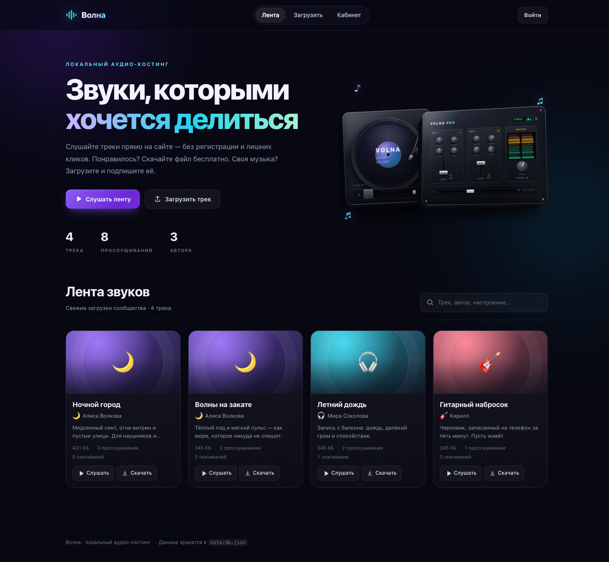
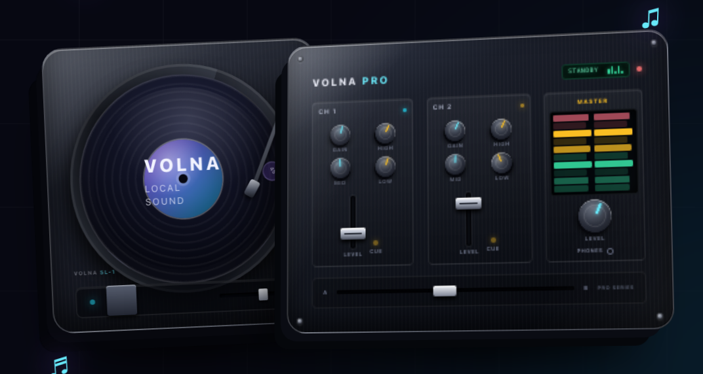
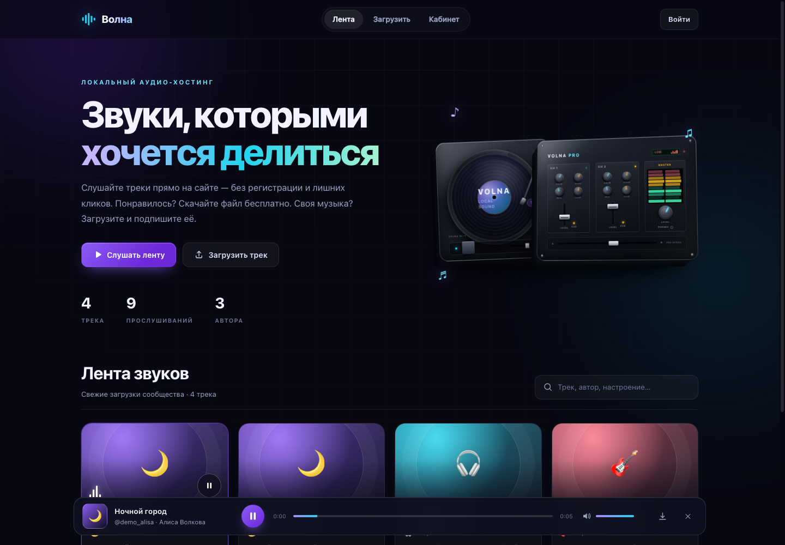
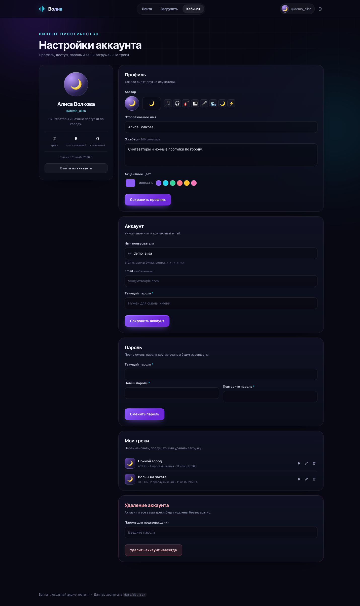
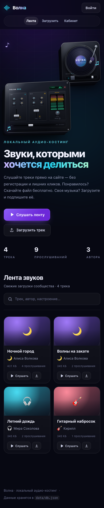

<div align="center">


# Волна

**Локальный аудио-хостинг с публичной лентой, аккаунтами и бесплатным скачиванием.**

Один Python-файл, JSON-база и ноль внешних зависимостей.

[](https://www.python.org/)
[](https://github.com/Xeuvy/Volna)
[](LICENSE)
[](https://github.com/Xeuvy/Volna/releases)
[](https://github.com/Xeuvy/Volna)

[Смотреть репозиторий](https://github.com/Xeuvy/Volna) · [Быстрый старт](#быстрый-старт) · [API](#api)

</div>



## О проекте

**Волна** — это небольшой, но полноценный сайт для обмена аудио, который
запускается на вашем компьютере одной командой. Он не требует Flask, Django,
Node.js, сборщиков или установки пакетов: весь сервер — это `server.py`
на стандартной библиотеке Python, а база данных — читаемый JSON-файл.

Главная идея: **слушать и скачивать может кто угодно, без регистрации**.
Аккаунт нужен только тем, кто хочет загружать свои треки и настраивать профиль.

Проект подойдёт как:

- личная локальная «фонотека» для друзей и домашней сети;
- учебный пример REST API, сессий, загрузки файлов и работы с JSON-базой;
- основа для собственного небольшого аудио-сервиса.

> На скриншотах показаны демонстрационные данные. В репозитории база пустая:
> при первом запуске создаётся новый `data/db.json` без пользователей и треков.

## Возможности

### Публичная часть

- **Лента треков** — доступна без входа и регистрации.
- **Встроенный плеер** — play/pause, перемотка, громкость, время, автопереход
  к следующему треку и закрытие плеера.
- **Потоковое аудио** — сервер поддерживает HTTP `Range`, поэтому перемотка
  работает даже у больших файлов.
- **Бесплатное скачивание** — с карточки трека или из плеера, без аккаунта.
- **Поиск** — по названию, описанию, имени пользователя и отображаемому имени.
- **Фильтр по автору** — один клик по имени в карточке.
- **Счётчики** — количество треков, прослушиваний и авторов; у каждого трека
  отдельно считаются прослушивания и скачивания.

### Аккаунты

- Регистрация, вход и выход; сессия живёт 30 дней.
- Пароли хранятся как **PBKDF2-SHA256** с солью и 240 000 итераций.
- Сессия — случайный токен в `HttpOnly`-cookie с `SameSite=Lax`.
- **Настройка профиля**: отображаемое имя, эмодзи-аватар, био, акцентный цвет.
- **Настройка аккаунта**: смена имени пользователя и email.
- **Смена пароля** с завершением всех остальных сеансов.
- **Удаление аккаунта** вместе со всеми загруженными файлами.
- **Свои треки**: переименование, прослушивание, удаление.
- Email и хеш пароля никогда не попадают в публичный API.

### Интерфейс

- Тёмная неоновая тема, стеклянные панели, адаптивная вёрстка.
- **3D-сцена DJ-сетапа**: вертушка и профессиональный микшер на CSS.
- Микшер «оживает» при воспроизведении: дисплей переключается в `LIVE`,
  VU-метры и светодиоды начинают работать быстрее.
- У микшера анимированы ручки, фейдеры, кроссфейдер, эквалайзер и индикаторы.
- Винил вращается строго вокруг своего центра; метка и отверстие отцентрованы.
- Полноценная мобильная версия: отдельная композиция hero, двухколоночная
  сетка карточек и компактный плеер.

### Техническая часть

- HTTP-сервер на `ThreadingHTTPServer`, без сторонних библиотек.
- JSON-база с атомарной записью через временный файл и `os.replace`.
- Потокобезопасные операции с базой (общий `RLock` на запись).
- Загрузка `multipart/form-data` с прогрессом на клиенте.
- Защита от path traversal при раздаче статики и аудио.
- Ограничение размера файла и белый список аудио-форматов.
- Публичный REST API и понятные ошибки в формате `{"error": "..."}`.

## Скриншоты

### Главная страница


### 3D-сцена: вертушка и микшер



### Плеер и режим LIVE



<details>
<summary>Настройки аккаунта и мобильная версия</summary>





</details>

## Технологии

| Слой | Что используется |
| --- | --- |
| Backend | Python 3.10+, `http.server`, `json`, `hashlib`, `secrets` |
| База | `data/db.json` + файлы в `data/uploads/` |
| Frontend | Vanilla HTML, CSS и JavaScript — без фреймворков и сборки |
| Аудио | HTML5 `<audio>`, HTTP `Range`, стриминг файлов |
| 3D | CSS-трансформации, `perspective`, `preserve-3d`, keyframes |
| Зависимости | Нет |

## Быстрый старт

### Требования

- Python **3.10 или новее**
- Любой современный браузер (Chrome, Safari, Firefox, Edge)

Проверить версию Python:

```bash
python3 --version
```

### Запуск

```bash
git clone https://github.com/Xeuvy/Volna.git
cd Volna
python3 server.py --open
```

Сайт откроется по адресу **http://127.0.0.1:8000/**.
Флаг `--open` запускает браузер автоматически; без него откройте адрес вручную.

Если папка уже скачана:

```bash
cd volna
python3 server.py --open
```

На Windows вместо `python3` обычно используется `python`.

### Другой порт

```bash
python3 server.py --port 8080
```

### Доступ с телефона в локальной сети

```bash
python3 server.py --host 0.0.0.0 --port 8000
```

Затем откройте `http://<IP-компьютера>:8000` на телефоне. Компьютер и телефон
должны быть в одной сети, а порт — разрешён в файрволе.

> **Важно:** сервер работает по HTTP и не предназначен для публикации в интернете.
> Не выставляйте его наружу без HTTPS, reverse proxy и дополнительной защиты.

## Как пользоваться

1. **Слушайте без аккаунта.** Откройте главную, нажмите «Слушать» на карточке
   или «Слушать ленту» в hero-блоке.
2. **Скачивайте бесплатно.** Кнопка «Скачать» сохранит оригинальный файл.
3. **Создайте аккаунт** через «Войти» → «Регистрация».
4. **Загрузите трек:** раздел «Загрузить», выберите файл, укажите название
   (обязательно) и описание (по желанию). После публикации трек сразу появится
   в общей ленте.
5. **Настройте профиль** в разделе «Кабинет»: имя, аватар, био, цвет, username,
   email и пароль.
6. **Управляйте своими треками** внизу кабинета: переименовать или удалить.

Поддерживаемые форматы: **MP3, WAV, OGG, OGA, OPUS, M4A, MP4, AAC, FLAC, WEBM**.
Максимальный размер — **80 МБ**.

## Структура проекта

```text
Volna/
├── .github/workflows/
│   ├── ci.yml             # проверка синтаксиса и smoke-тест
│   └── release.yml        # автоматический GitHub Release по тегу v*
├── server.py              # сервер, API, JSON-база, сессии, раздача файлов
├── README.md
├── LICENSE
├── .gitignore
├── .editorconfig
├── docs/                  # скриншоты для README
│   ├── preview-home.png
│   ├── preview-mixer.png
│   ├── preview-player.png
│   ├── preview-account.png
│   └── preview-mobile.png
├── data/
│   ├── db.json            # создаётся при первом запуске (не хранится в Git)
│   └── uploads/           # загруженные аудиофайлы (не хранятся в Git)
└── static/
    ├── index.html         # разметка всех экранов
    ├── styles.css         # тема, адаптивность, 3D-сцена
    ├── app.js             # клиентская логика и плеер
    └── favicon.svg
```

## Данные и JSON-база

Вся метаинформация хранится в `data/db.json`. Схема верхнего уровня:

```json
{
  "meta": { "version": 1, "created_at": "2026-01-01T00:00:00+00:00" },
  "users": {
    "<user-id>": {
      "id": "<user-id>",
      "username": "alice",
      "display_name": "Алиса",
      "email": "alice@example.com",
      "bio": "Люблю синтезаторы",
      "avatar": "🌙",
      "accent": "#8b5cf6",
      "password_hash": "pbkdf2_sha256$240000$<salt>$<hash>",
      "created_at": "2026-01-01T00:00:00+00:00"
    }
  },
  "sessions": {
    "<token>": {
      "user_id": "<user-id>",
      "created_at": "2026-01-01T00:00:00+00:00",
      "expires_at": 1767225600.0
    }
  },
  "tracks": {
    "<track-id>": {
      "id": "<track-id>",
      "title": "Ночной город",
      "description": "Описание",
      "user_id": "<user-id>",
      "filename": "<track-id>.mp3",
      "original_name": "night-city.mp3",
      "mime": "audio/mpeg",
      "ext": ".mp3",
      "size": 5242880,
      "plays": 0,
      "downloads": 0,
      "created_at": "2026-01-01T00:00:00+00:00"
    }
  }
}
```

Аудиофайлы лежат отдельно в `data/uploads/` под сгенерированными именами.
Запись базы атомарная: сначала данные пишутся в `.tmp`, затем заменяют основной
файл через `os.replace`. При повреждении JSON сервер сохраняет резервную копию
и создаёт новую пустую базу.

## API

Все ответы — JSON, кроме аудио и статики. Ошибки имеют вид `{"error": "..."}`.

| Метод | Путь | Доступ | Назначение |
| --- | --- | --- | --- |
| `POST` | `/api/register` | все | Регистрация: `username`, `password`, опционально `display_name` |
| `POST` | `/api/login` | все | Вход: `username`, `password` |
| `POST` | `/api/logout` | вход | Выход и удаление сессии |
| `GET` | `/api/me` | все | Текущий пользователь или `null` |
| `PATCH` | `/api/account` | вход | Профиль, username, email, пароль |
| `POST` | `/api/account/delete` | вход | Удаление аккаунта: `password` |
| `GET` | `/api/tracks?q=...&author=...` | все | Публичная лента, поиск и фильтр |
| `POST` | `/api/tracks` | вход | Загрузка (`multipart/form-data`: `title`, `description`, `file`) |
| `PATCH` | `/api/tracks/<id>` | владелец | Изменить название/описание |
| `DELETE` | `/api/tracks/<id>` | владелец | Удалить свой трек и файл |
| `POST` | `/api/tracks/<id>/play` | все | +1 к прослушиваниям |
| `GET` | `/api/tracks/<id>/download` | все | Скачать файл (бесплатно) |
| `GET` | `/audio/<id>` | все | Потоковое аудио с `Range` |
| `GET` | `/health` | все | Проверка работоспособности |

### Пример: регистрация

```bash
curl -c cookies.txt \
  -H 'Content-Type: application/json' \
  -d '{"username":"alice","display_name":"Алиса","password":"secret123"}' \
  http://127.0.0.1:8000/api/register
```

### Пример: загрузка трека

```bash
curl -b cookies.txt \
  -F 'title=Ночной город' \
  -F 'description=Медленный синт' \
  -F 'file=@night-city.mp3;type=audio/mpeg' \
  http://127.0.0.1:8000/api/tracks
```

## Безопасность

- Пароли: PBKDF2-HMAC-SHA256, соль 16 байт, 240 000 итераций.
- Сравнение хешей — `hmac.compare_digest`.
- Сессии: 32 байта энтропии, `HttpOnly`, `SameSite=Lax`, срок 30 дней.
- Смена пароля завершает все сессии пользователя, кроме текущей.
- Публичный API отдаёт только безопасные поля профиля.
- Имена загруженных файлов генерируются на сервере; исходное имя очищается.
- Проверка расширения и размера; path traversal для статики и аудио закрыт.
- Ответы API не кешируются; для статики — `no-cache` и проверка типов.
- CSRF-риск снижен за счёт `SameSite=Lax` и JSON-запросов.

Чего здесь **нет** (важно для честности):

- HTTPS и reverse proxy;
- подтверждения email и восстановления пароля;
- rate limit и капчи;
- антивирусной проверки загруженных файлов;
- модерации и приватных профилей;
- промышленного уровня тестов и горизонтального масштабирования.

Это локальный инструмент, а не продакшн-сервис.

## Ограничения

| Параметр | Значение |
| --- | --- |
| Максимальный размер файла | 80 МБ |
| Форматы | MP3, WAV, OGG, OGA, OPUS, M4A, MP4, AAC, FLAC, WEBM |
| Название трека | 1–120 символов |
| Описание | до 1000 символов |
| Имя пользователя | 3–24 символа: буквы, цифры, `_`, `-`, `.` |
| Пароль | от 6 символов |
| Био | до 300 символов |
| Аватар | эмодзи до 8 символов |
| Сессия | 30 дней |

Проверка формата идёт по расширению: файл с переименованным расширением
может загрузиться, но не проиграется. Для локального проекта это осознанный
компромисс.

## Настройки запуска

```text
python3 server.py [--host HOST] [--port PORT] [--open]
```

| Флаг | По умолчанию | Описание |
| --- | --- | --- |
| `--host` | `127.0.0.1` | Адрес прослушивания. `0.0.0.0` — доступ в локальной сети |
| `--port` | `8000` | Порт |
| `--open` | выключен | Открыть сайт в браузере через 0,6 секунды |

## Резервное копирование и сброс

Остановите сервер и скопируйте папку `data/`:

```bash
cp -R data ~/Desktop/volna-backup
```

Полный сброс (удалить аккаунты, треки и файлы):

```bash
rm -f data/db.json
rm -f data/uploads/*
```

После следующего запуска база создастся заново. Папки `data/` и
`data/uploads/` сервер создаёт автоматически.

## Разработка

- Сервер не требует установки зависимостей и виртуального окружения.
- Frontend не собирается: правьте `static/*` и обновляйте страницу.
- После изменений Python перезапустите `server.py`.
- Полезные проверки:

```bash
python3 -m py_compile server.py
node --check static/app.js
```

- В репозитории настроены два GitHub Actions workflow:
  - `ci.yml` — проверка синтаксиса Python/JavaScript и smoke-тест сервера;
  - `release.yml` — автоматическая публикация GitHub Release по тегу `v*`.
- `data/db.json` и загруженные файлы намеренно исключены из Git.

## Roadmap

Идеи для развития, а не обещания:

- плейлисты и избранное;
- волновая форма и определение длительности на сервере;
- теги, жанры и серверный поиск;
- загрузка изображений-обложек и аватаров;
- OAuth / восстановление пароля;
- Docker-образ и публичный деплой за reverse proxy;
- автоматические интеграционные тесты API.

## Версии и релизы

Текущая версия — **v1.1**. Релизы и сгенерированные списки изменений доступны
на [GitHub Releases](https://github.com/Xeuvy/Volna/releases).

Чтобы выпустить следующую версию, достаточно создать и запушить тег:

```bash
git tag -a v1.2 -m "Волна v1.2"
git push origin v1.2
```

Workflow `release.yml` сам создаст релиз, приложит автоматические release notes
и отметит его как latest.

## Лицензия

Проект распространяется по лицензии **MIT**.
Подробности — в файле [LICENSE](LICENSE).

## Автор

**Xeuvy** · [github.com/Xeuvy](https://github.com/Xeuvy)

Репозиторий: [github.com/Xeuvy/Volna](https://github.com/Xeuvy/Volna)

Если проект оказался полезен — поставьте звезду ⭐
