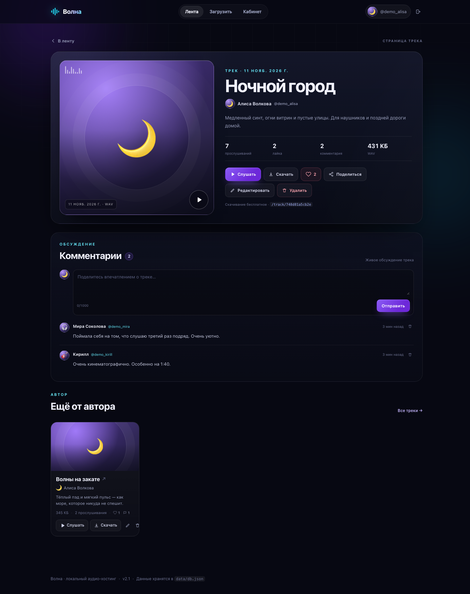
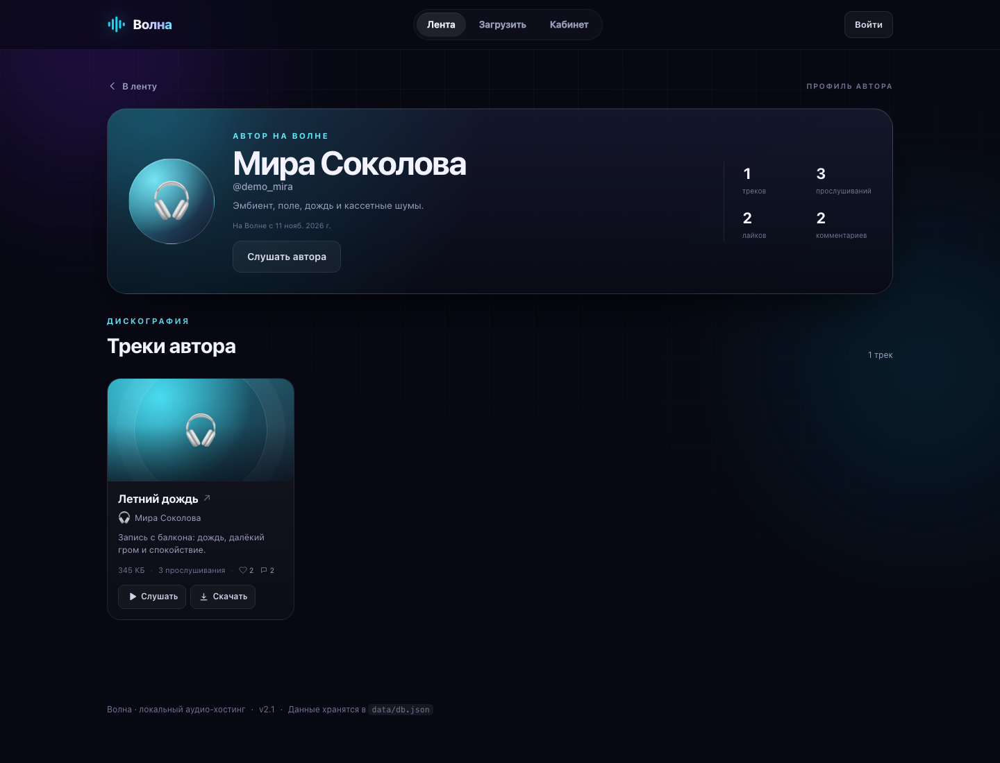
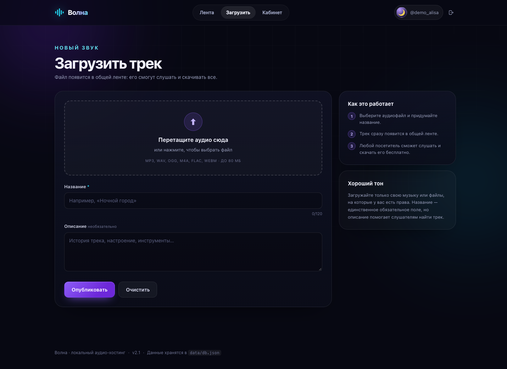
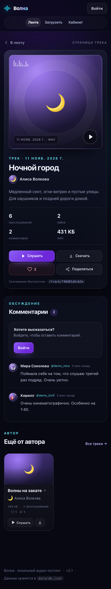

<div align="center">


# Волна

**Локальный аудио-хостинг с публичной лентой, профилями, комментариями и бесплатным скачиванием.**

Версия **2.2** · Python + JSON · ноль внешних зависимостей

[](https://www.python.org/)
[](https://github.com/Xeuvy/Volna/releases)
[](https://github.com/Xeuvy/Volna)
[](LICENSE)

[Репозиторий](https://github.com/Xeuvy/Volna) · [Релизы](https://github.com/Xeuvy/Volna/releases)

</div>


## Быстрые ссылки

- [Быстрый старт](#быстрый-старт)
- [Возможности](#возможности)
- [Скриншоты](#скриншоты)
- [Что нового в v2.2](#что-нового-в-v22)
- [Оптимизация](#оптимизация)
- [Данные и JSON-база](#данные-и-json-база)
- [API](#api)
- [Безопасность](#безопасность)
- [Решение проблем](#решение-проблем)
- [Версии и релизы](#версии-и-релизы)

## Быстрый старт

### Требования

- Python **3.10+**
- Современный браузер: Chrome, Safari, Firefox или Edge
- Больше ничего устанавливать не нужно

Проверить Python:

```bash
python3 --version
```

### Запуск

```bash
git clone https://github.com/Xeuvy/Volna.git
cd Volna
python3 server.py --open
```

Сайт откроется по адресу **http://127.0.0.1:8000/**.
Флаг `--open` запускает браузер; без него откройте адрес вручную.

Если папка уже скачана:

```bash
cd volna
python3 server.py --open
```

На Windows обычно используется:

```powershell
python server.py --open
```

Другой порт:

```bash
python3 server.py --port 8080
```

Доступ с телефона в той же Wi-Fi-сети:

```bash
python3 server.py --host 0.0.0.0 --port 8000
```

Затем откройте `http://<IP-компьютера>:8000` на телефоне.

> Сервер работает по HTTP и рассчитан на локальную сеть. Не публикуйте его
> в интернете без HTTPS, reverse proxy и дополнительной защиты.

## Возможности

### Публичная часть

- **Лента без регистрации** — слушать и скачивать может любой посетитель.
- **Плеер** — play/pause, перемотка, громкость, автопереход к следующему треку.
- **HTTP Range** — перемотка работает даже у больших аудиофайлов.
- **Бесплатное скачивание** — с карточки, страницы трека или из плеера.
- **Поиск** — по названию, описанию, имени пользователя и отображаемому имени.
- **Счётчики** — прослушивания, лайки, комментарии, скачивания.
- **Адаптивность** — отдельные компоновки для десктопа и телефона.

### Страница каждого трека

- Постоянный адрес `/track/<id>` и нормальные мета-теги для соцсетей.
- Большая обложка, автор, описание, размер, формат, дата и статистика.
- Прослушивание, скачивание, лайк и кнопка «Поделиться».
- **Комментарии**: оставить, прочитать, удалить свой комментарий или
  комментарий на своём треке.
- **Похожие треки автора** и переход в публичный профиль.
- Владелец может переименовать или удалить трек прямо со страницы.

### Аккаунты и профили

- Регистрация, вход, выход; сессия живёт **30 дней**.
- **Публичный профиль** `/u/<username>`: аватар, био, статистика и все треки.
- Настройка профиля: отображаемое имя, эмодзи-аватар, био, акцентный цвет.
- Смена имени пользователя и email.
- Смена пароля с завершением остальных сеансов.
- **«Понравившиеся»** — все треки, отмеченные ♥.
- **«Мои комментарии»** — история отзывов со ссылками на треки.
- **Сессия в cookie**: срок действия, последний вход и кнопка
  «Завершить все другие сеансы».
- Удаление аккаунта вместе с треками, комментариями и лайками.

### 3D-сцена

- Вертушка и профессиональный микшер на CSS.
- При воспроизведении микшер переключается в `LIVE`: VU-метры, светодиоды
  и дисплей начинают работать активнее.
- Анимированы ручки, фейдеры, кроссфейдер, эквалайзер и подсветка.
- Винил вращается строго вокруг центра; метка и отверстие отцентрованы.

## Скриншоты

### Главная


### Страница трека и комментарии



### 3D-сцена


### Плеер и режим LIVE


<details>
<summary><strong>Профиль автора, кабинет, загрузка и мобильная версия</strong></summary>

#### Публичный профиль автора



#### Настройки аккаунта


#### Загрузка трека



#### Мобильная главная


#### Мобильная страница трека



</details>

> На скриншотах — демонстрационные данные. В репозитории база пустая:
> `data/db.json` создаётся при первом запуске и не хранится в Git.

## Что нового в v2.2

- **Исправлен сброс сессии после загрузки трека.** Сервер заново выдаёт
  подписанную cookie прямо в ответе `POST /api/tracks`, а клиент больше не
  делает промежуточный запрос `/api/me`, из-за которого мог показать форму входа.
- **Cookie теперь содержит и `Expires`, и `Max-Age`** — сессия надёжнее
  переживает загрузку и перезапуск браузера.
- Загрузка по-прежнему сразу открывает страницу нового трека.

## Что нового в v2.1

- **Сессии переехали в подписанные cookie.** Таблицы `sessions` в базе больше
  нет: в cookie лежит подписанный HMAC-SHA256 набор `user_id + версия + срок`,
  а сервер проверяет подпись и версию сессии.
- **Страницы треков** `/track/<id>` с комментариями, лайками, шарингом и
  похожими треками.
- **Публичные профили** `/u/<username>`.
- **Лайки и комментарии** с проверкой прав на удаление.
- **Расширенный кабинет**: понравившиеся треки, свои комментарии, срок сессии,
  последний вход и завершение остальных сеансов.
- **Оптимизация**: компактный JSON без отступов, отсутствие таблицы сессий,
  ETag/304 для статики, ленивая загрузка комментариев, агрегированные счётчики.
- **Исправлена центровка винила**: метка и отверстие выровнены по центру,
  диск вращается вокруг своей оси (проверено на 1440/390/320 px).
- **Чистые URL** вместо hash-навигации: `/`, `/upload`, `/account`,
  `/track/<id>`, `/u/<username>`.
- **Больше скриншотов и раздел «Решение проблем»** в README.

## Оптимизация

В v2.x особое внимание уделено скорости и размеру базы:

| Что сделано | Эффект |
| --- | --- |
| Cookie-сессии вместо таблицы `sessions` | Меньше база и никаких записей сессии при каждом запросе |
| Компактный JSON (`separators`) | База меньше в несколько раз по сравнению с `indent=2` |
| Нормализованные комментарии | Комментарии не дублируются внутри треков |
| Лайки как список ID в треке | Быстрый подсчёт и компактное хранение |
| Комментарии только на странице трека | Лента не тянет весь текст обсуждений |
| ETag / `304 Not Modified` | Браузер не перекачивает неизменившиеся CSS/JS |
| Сжатый JSON API | Меньше трафика |
| HTTP `Range` для аудио | Мгновенная перемотка без полной загрузки |
| Счётчики через агрегацию | Один проход по данным вместо N запросов |

Демо-база с **3 пользователями, 4 треками, 6 комментариями и лайками**
занимает около **4,5 КБ** в `data/db.json` (без аудиофайлов).

## Данные и JSON-база

Вся метаинформация хранится в `data/db.json`. Схема v2:

```json
{
  "meta": { "version": 2, "created_at": "2026-01-01T00:00:00+00:00" },
  "users": {
    "<user-id>": {
      "id": "<user-id>",
      "username": "alice",
      "display_name": "Алиса",
      "email": "alice@example.com",
      "bio": "Люблю синтезаторы",
      "avatar": "🌙",
      "accent": "#8b5cf6",
      "password_hash": "pbkdf2_sha256$240000$<salt>$<hash>",
      "session_version": 0,
      "created_at": "2026-01-01T00:00:00+00:00",
      "last_login_at": "2026-01-01T00:00:00+00:00"
    }
  },
  "tracks": {
    "<track-id>": {
      "id": "<track-id>",
      "title": "Ночной город",
      "description": "Описание",
      "user_id": "<user-id>",
      "filename": "<track-id>.mp3",
      "original_name": "night-city.mp3",
      "mime": "audio/mpeg",
      "ext": ".mp3",
      "size": 5242880,
      "plays": 0,
      "downloads": 0,
      "likes": ["<user-id>"],
      "created_at": "2026-01-01T00:00:00+00:00"
    }
  },
  "comments": {
    "<comment-id>": {
      "id": "<comment-id>",
      "track_id": "<track-id>",
      "user_id": "<user-id>",
      "text": "Отличный трек!",
      "created_at": "2026-01-01T00:00:00+00:00"
    }
  }
}
```

- `data/db.json` пишется атомарно: временный файл → `fsync` → `os.replace`.
- При повреждении JSON создаётся резервная копия `.broken-<timestamp>`.
- `data/secret.key` — 32-байтный ключ подписи cookie-сессий. Он создаётся сам,
  имеет права `600` и **исключён из Git**.
- Аудиофайлы лежат в `data/uploads/` под сгенерированными именами.
- `data/db.json` и `data/uploads/*` также исключены из Git.

## API

Все ответы — JSON, кроме аудио и статики. Ошибки: `{"error": "..."}`.

| Метод | Путь | Доступ | Назначение |
| --- | --- | --- | --- |
| `POST` | `/api/register` | все | Регистрация |
| `POST` | `/api/login` | все | Вход, выдаёт подписанную cookie |
| `POST` | `/api/logout` | вход | Выход (очищает cookie) |
| `GET` | `/api/me` | все | Пользователь, срок cookie-сессии |
| `GET` | `/api/me/likes` | вход | Понравившиеся треки |
| `GET` | `/api/me/comments` | вход | Свои комментарии |
| `PATCH` | `/api/account` | вход | Профиль, username, email, пароль |
| `POST` | `/api/account/logout-all` | вход | Завершить остальные сеансы |
| `POST` | `/api/account/delete` | вход | Удаление аккаунта |
| `GET` | `/api/tracks` | все | Лента, `q`, `author`, `sort=new\|popular\|discussed` |
| `GET` | `/api/tracks/<id>` | все | Трек, комментарии, похожие треки |
| `POST` | `/api/tracks` | вход | Загрузка (`multipart/form-data`) |
| `PATCH` | `/api/tracks/<id>` | владелец | Изменить трек |
| `DELETE` | `/api/tracks/<id>` | владелец | Удалить трек и его комментарии |
| `POST` | `/api/tracks/<id>/play` | все | +1 к прослушиваниям |
| `POST` | `/api/tracks/<id>/like` | вход | Поставить/убрать лайк |
| `POST` | `/api/tracks/<id>/comments` | вход | Добавить комментарий |
| `DELETE` | `/api/comments/<id>` | автор/владелец трека | Удалить комментарий |
| `GET` | `/api/users/<username>` | все | Публичный профиль и треки |
| `GET` | `/api/tracks/<id>/download` | все | Бесплатное скачивание |
| `GET` | `/audio/<id>` | все | Потоковое аудио с `Range` |
| `GET` | `/health` | все | Статус и версия |

### Пример: регистрация и загрузка

```bash
curl -c cookies.txt \
  -H 'Content-Type: application/json' \
  -d '{"username":"alice","display_name":"Алиса","password":"secret123"}' \
  http://127.0.0.1:8000/api/register

curl -b cookies.txt \
  -F 'title=Ночной город' \
  -F 'description=Медленный синт' \
  -F 'file=@night-city.mp3;type=audio/mpeg' \
  http://127.0.0.1:8000/api/tracks
```

## Безопасность

- **Пароли:** PBKDF2-HMAC-SHA256 с солью и 240 000 итераций.
- **Cookie-сессии:** подпись HMAC-SHA256, `HttpOnly`, `SameSite=Lax`,
  срок 30 дней. В cookie лежат только `user_id`, версия и срок — без пароля.
- **Секрет подписи:** `data/secret.key`, 32 байта, права `600`, не в Git.
  При удалении файла все сессии становятся недействительными.
- **Отзыв сессий:** смена пароля и «Завершить все другие сеансы» увеличивают
  `session_version`; старые cookie перестают работать.
- **Права:** удалить комментарий может автор комментария или владелец трека;
  редактировать трек — только владелец.
- **Публичный API** не отдаёт email и хеш пароля.
- **Загрузки:** проверка расширения, размера (80 МБ), сгенерированные имена,
  защита от path traversal.
- **XSS:** пользовательский текст экранируется на клиенте и отдаётся как JSON.
- **CSRF:** `SameSite=Lax` + JSON-запросы; для локального проекта этого достаточно.

Чего нет: HTTPS, rate limit, подтверждения email, антивирусной проверки,
модерации и готовности к публичному продакшену.

## Ограничения

| Параметр | Значение |
| --- | --- |
| Размер файла | до 80 МБ |
| Форматы | MP3, WAV, OGG, OGA, OPUS, M4A, MP4, AAC, FLAC, WEBM |
| Название | 1–120 символов |
| Описание | до 1000 символов |
| Комментарий | 1–1000 символов |
| Username | 3–24 символа: буквы, цифры, `_`, `-`, `.` |
| Пароль | от 6 символов |
| Био | до 300 символов |
| Сессия | 30 дней |

## Структура проекта

```text
Volna/
├── .github/workflows/
│   ├── ci.yml             # синтаксис + smoke-тест
│   └── release.yml        # авторелиз по тегу v*
├── server.py              # HTTP, API, JSON-база, cookie-сессии
├── README.md
├── LICENSE
├── .gitignore
├── .editorconfig
├── docs/                  # скриншоты для README
├── data/
│   ├── db.json            # создаётся при первом запуске (не в Git)
│   ├── secret.key         # ключ подписи сессий (не в Git)
│   └── uploads/           # аудиофайлы (не в Git)
└── static/
    ├── index.html
    ├── styles.css
    ├── app.js
    └── favicon.svg
```

## Настройки запуска

```text
python3 server.py [--host HOST] [--port PORT] [--open]
```

| Флаг | По умолчанию | Описание |
| --- | --- | --- |
| `--host` | `127.0.0.1` | Адрес; `0.0.0.0` — доступ в локальной сети |
| `--port` | `8000` | Порт |
| `--open` | выкл. | Открыть браузер после старта |

## Резервное копирование и сброс

Остановите сервер и скопируйте `data/`:

```bash
cp -R data ~/Desktop/volna-backup
```

Полный сброс:

```bash
rm -f data/db.json data/secret.key
rm -f data/uploads/*
```

После запуска база и новый ключ сессий создадутся автоматически.

## Решение проблем

### `Address already in use` / порт занят

Запустите на другом порту:

```bash
python3 server.py --port 8001
```

Или найдите процесс:

```bash
lsof -i :8000
```

### `python3: command not found`

Установите Python 3.10+ с [python.org](https://www.python.org/downloads/).
На Windows попробуйте `python server.py --open`.

### Трек загрузился, но не играет

- Проверьте, что расширение соответствует реальному формату файла.
- Safari может не поддерживать часть форматов (например, OGG/FLAC).
- Скачайте файл и откройте в локальном плеере — так исключается проблема браузера.
- Сервер проверяет формат по расширению, а не по содержимому.

### Не работают вход, лайки или комментарии

- Убедитесь, что в браузере разрешены cookie для `127.0.0.1`.
- Если менялся пароль, старые сессии специально завершаются — войдите снова.
- Если удалили `data/secret.key`, все сессии инвалидируются; это нормально.
- Очистите cookie сайта и войдите заново.

### После перезапуска «слетел» вход

Проверьте, что `data/secret.key` не удалён и доступен на запись. Именно он
подписывает cookie. Удаление ключа = выход на всех устройствах.

### Загрузка не проходит

- Максимум **80 МБ**.
- Разрешены только поддерживаемые расширения.
- Проверьте свободное место и права на `data/uploads/`.

### Комментарий не отправляется

Нужно войти в аккаунт. Если сессия истекла, откроется форма входа; после входа
вернитесь на страницу трека.

### База повреждена

Сервер сохранит копию `data/db.json.broken-*` и создаст новую пустую базу.
Резервную копию можно восстановить, заменив `data/db.json` и перезапустив сервер.

### Сайт не открывается с телефона

- Запустите с `--host 0.0.0.0`.
- Проверьте IP компьютера и одну Wi-Fi-сеть.
- Разрешите порт в файрволе macOS/Windows.

## Версии и релизы

Текущая версия — **v2.2**. Все изменения и релизы:
[github.com/Xeuvy/Volna/releases](https://github.com/Xeuvy/Volna/releases).

Workflow `release.yml` автоматически создаёт релиз и release notes при пуше тега:

```bash
git tag -a v2.3 -m "Волна v2.3"
git push origin v2.3
```

## Лицензия

Проект распространяется по лицензии **MIT**.
Подробности — в [LICENSE](LICENSE).

## Автор

**Xeuvy** · [github.com/Xeuvy](https://github.com/Xeuvy)

Репозиторий: [github.com/Xeuvy/Volna](https://github.com/Xeuvy/Volna)

Если проект полезен — поставьте звезду ⭐
